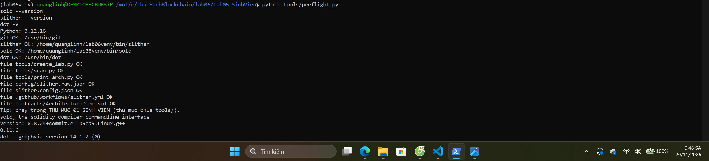
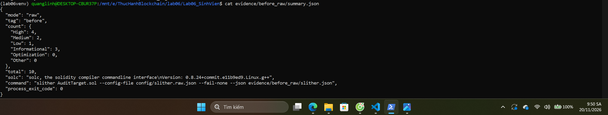
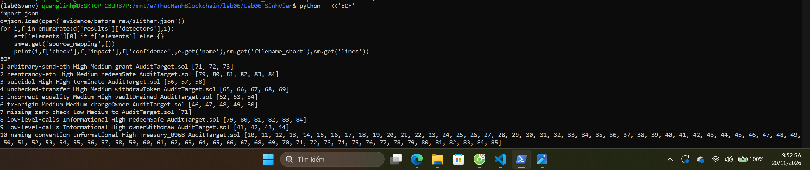
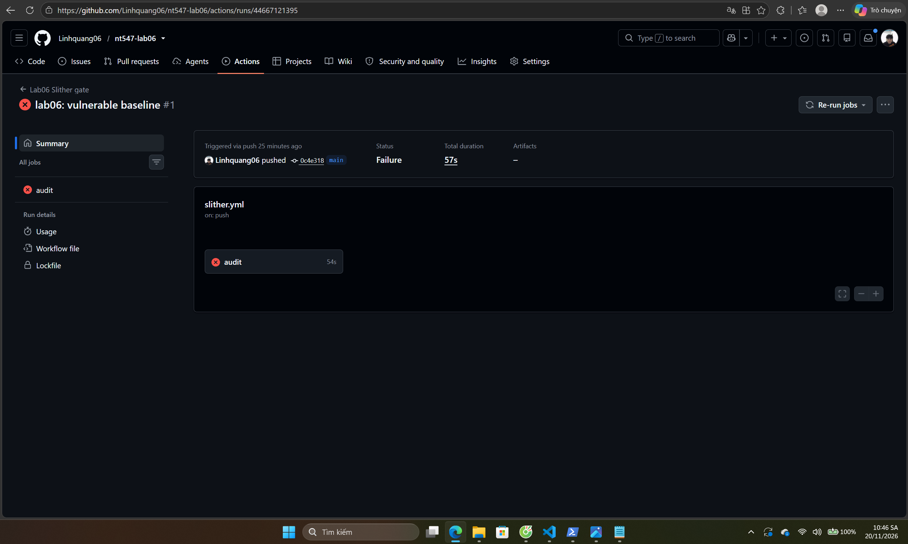
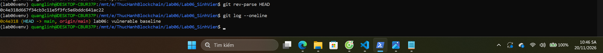

# NT547 - LAB 06 - BÁO CÁO (TỰ ĐIỀN)

**MSSV:** 24520968  | **Họ tên:** Phạm Quang Linh | **Lớp:** NT547.R11.ANTT
**Session code tự sinh:** SC-EE4262 | **Tên contract:** Treasury_0968
**Solidity / Slither:** 0.8.24 / 0.11.6 | **Ngày hoàn thành:** ...
**URL GitHub repository:** ...

## 1. Static scan (2,0 điểm)

- Lệnh raw: `python tools/scan.py --mode raw --tag before`
- Số lượng finding raw từ `evidence/before_raw/summary.json`:
  - High: 4; Medium: 2; Low: 1; Informational: 3; Optimization: 0
- Chạy configured: `python tools/scan.py --mode configured --tag before`

- So sánh raw/configured: raw có 10 finding, configured còn 6 (4 High, 2 Medium). Config chỉ ẩn Low/Informational (và solc-version), High/Medium không biến mất.

- 3 detector **khác tên**: arbitrary-send-eth, suicidal, tx-origin

| ID finding | Detector | Impact | Confidence | Source (file:dòng) | Luồng dữ liệu: đầu vào -> thao tác -> tác hại |
|---|---|---|---|---|---|
| F01 | arbitrary-send-eth | High | Medium | AuditTarget.sol:71-73, hàm grant | Bất kỳ ai gọi grant(to, amount), không có kiểm tra quyền → to.transfer(amount) gửi ETH của contract đến địa chỉ tùy ý → rút cạn quỹ |
| F02 | suicidal	 | High | High | AuditTarget.sol:56-58, hàm terminate | Bất kỳ ai gọi terminate() → selfdestruct(payable(msg.sender)) → toàn bộ ETH chuyển cho người gọi |
| F03 | tx-origin	 | Medium | Medium | AuditTarget.sol:46-50, hàm changeOwner | Owner bị dụ gọi contract độc hại → contract đó gọi changeOwner(attacker), tx.origin vẫn là owner nên qua kiểm tra → owner bị đổi sang kẻ tấn công |

## 2. Triage và sửa lỗi (2,5 điểm)

Đọc toàn bộ AuditTarget.sol: nhận diện **4 mẫu lỗi thật + 2 đoạn cần đánh giá ngữ cảnh**,
kể cả khi Slither không hiển thị đủ 6 cảnh báo. Với mẫu không có detector,
ghi “Manual review / Not reported”, KHÔNG sửa slither.json hoặc tạo finding giả.

| Detector + vị trí | TP / FP / Chưa kết luận | Bằng chứng kiểm soát/khả năng khai thác | Biện pháp (Fix / Accept có lý do) | Sau sửa |
|---|---|---|---|---|
| | | | | |
| | | | | |
| | | | | |
| | | | | |
| | | | | |
| | | | | |

- Mô tả ít nhất 01 kịch bản khai thác TP: người gọi -> điều kiện -> call/state -> hậu quả: ...
- Phân tích 01 finding có severity cao nhưng risk thực tế không tương ứng: ...
- Dẫn bằng chứng `git diff`, scan before/after và giải thích cảnh báo còn lại: ...
- Lý do của mọi `slither-disable-next-line`: ... (tên detector, đúng vị trí, kiểm soát bù trừ).

## 3. Kiến trúc / Inheritance (1,5 điểm)

- Lệnh printer đã chạy: ...
- Ảnh `evidence/architecture/inheritance.png` (hoặc .dot, nếu Graphviz chưa có): ...
- Access control nằm ở ...; logic số dư nằm ở ...; contract triển khai nằm ở ...
- Giải thích 3–5 câu điểm audit cần bắt đầu: ...

## 4. Red -> Green CI (2,5 điểm)

| Phase | Commit (full/short SHA) | Run URL | Kết quả | Detector khiến RED / lý do GREEN |
|---|---|---|---|---|
| Baseline vulnerable | 0c4e318d667f34cb3c11e5f3fc5e6bddc641ac22 (0c4e318) | https://github.com/Linhquang06/nt547-lab06/actions/runs/44667121395 | RED | arbitrary-send-eth, reentrancy-eth, suicidal, unchecked-transfer (High); incorrect-equality, tx-origin (Medium) |
| Patched | | | GREEN | |

- So sánh local `--fail-none` (thu thập findings) với CI `fail-on: medium`: ...
- `exclude_low/informational` thay đổi kết quả hiển thị ra sao: ...

## 5. Mutation RED -> GREEN (1,5 điểm)

- Mutation một dòng: `require(msg.sender == owner, "not owner")` -> `require(tx.origin == owner, "not owner")` trong `modifier onlyOwner`.
- Detector kỳ vọng: `tx-origin` (mức Medium); xác nhận của em từ CI: ...

| Phase | Commit SHA | Run URL | Kết quả |
|---|---|---|---|
| Mutation | | | RED |
| Revert mutation | | | GREEN |

- Giải thích sự thay đổi về nguồn định danh/authorization: ...

## 6. Bằng chứng, tự kiểm

- [ ] `AuditTarget.sol`, `lab_identity.json`
- [ ] `evidence/before_raw/` và `evidence/before_configured/`
- [ ] `evidence/after_raw/` và `evidence/after_configured/`
- [ ] `evidence/architecture/`
- [ ] 04 URL Actions run RED/GREEN/RED/GREEN + 04 commit SHA
- [ ] Link repo và ảnh màn hình có terminal / URL / commit SHA; không cắt mất ngữ cảnh
- [ ] Các finding được triage, không chép lại mô tả detector thay cho suy luận
- [ ] Tuyệt đối không có seed phrase, private key, credentials

**Nhận xét cuối cùng (5–7 câu):** ...
