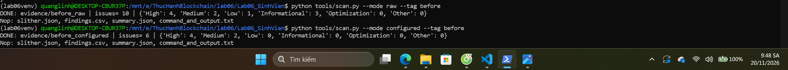
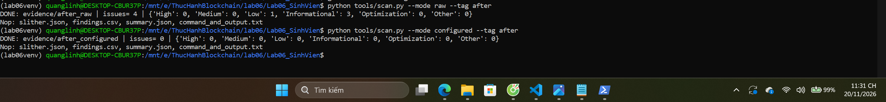
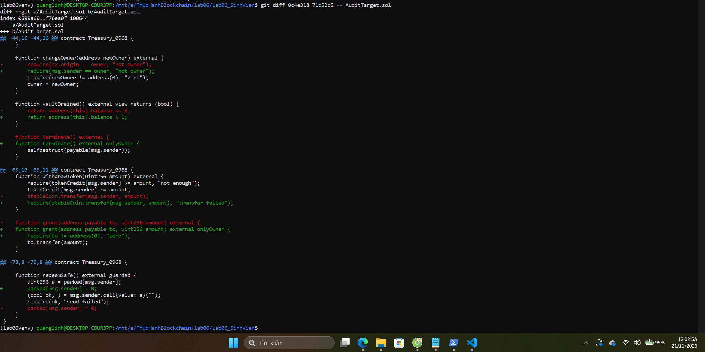
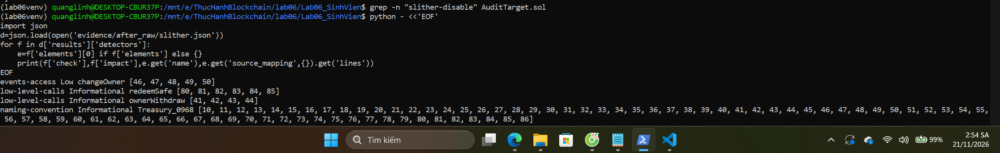
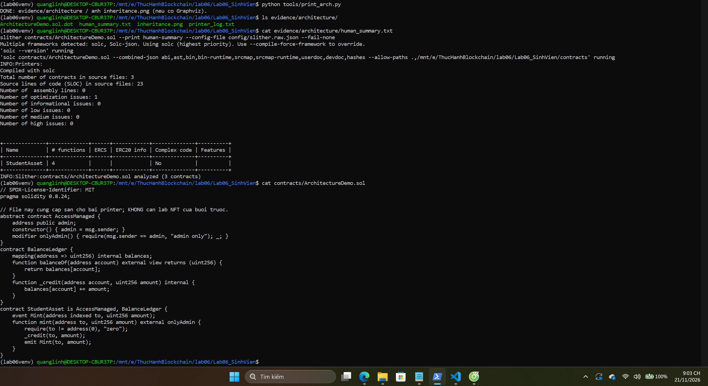
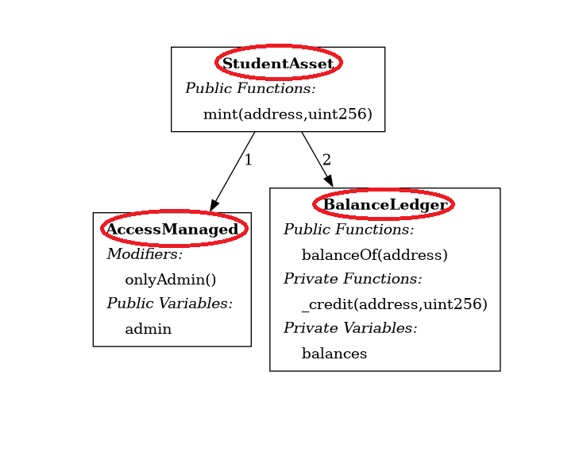
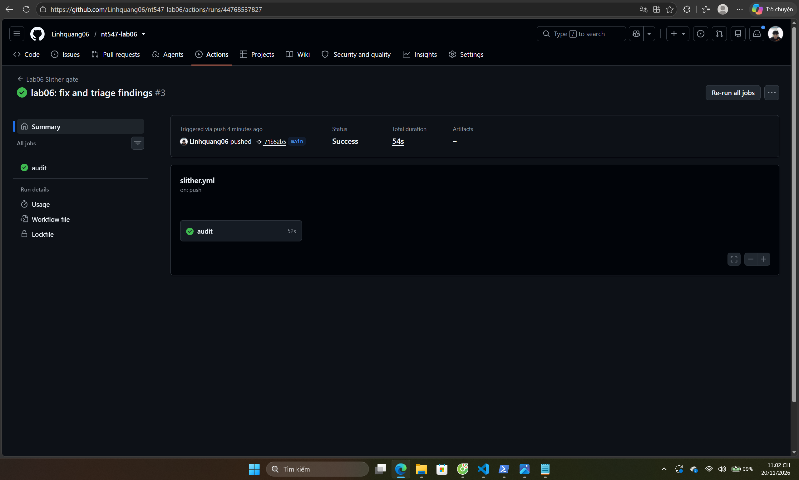
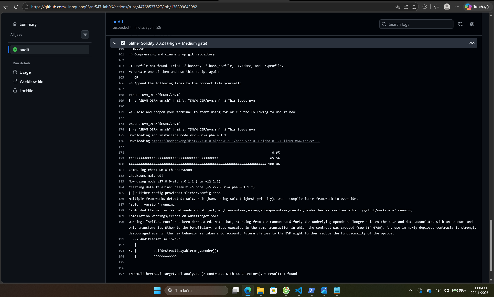
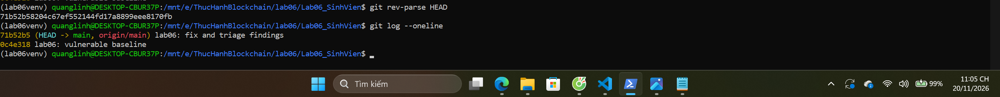

# NT547 - LAB 06 - BÁO CÁO (TỰ ĐIỀN)

**MSSV:** 24520968  | **Họ tên:** Phạm Quang Linh | **Lớp:** NT547.R11.ANTT
**Session code tự sinh:** SC-EE4262 | **Tên contract:** Treasury_0968
**Solidity / Slither:** 0.8.24 / 0.11.6 | **Ngày hoàn thành:** ...
**URL GitHub repository:** ...

## 1. Static scan (2,0 điểm)

- Lệnh raw: `python tools/scan.py --mode raw --tag before`
- Số lượng finding raw từ `evidence/before_raw/summary.json`:
  - High: 4; Medium: 2; Low: 1; Informational: 3; Optimization: 0
- Chạy configured: `python tools/scan.py --mode configured --tag before`

- So sánh raw/configured: raw có 10 finding, configured còn 6 (4 High, 2 Medium). Config chỉ ẩn Low/Informational (và solc-version), High/Medium không biến mất.

- 3 detector **khác tên**: arbitrary-send-eth, suicidal, tx-origin

| ID finding | Detector | Impact | Confidence | Source (file:dòng) | Luồng dữ liệu: đầu vào -> thao tác -> tác hại |
|---|---|---|---|---|---|
| F01 | arbitrary-send-eth | High | Medium | AuditTarget.sol:71-73, hàm grant | Bất kỳ ai gọi grant(to, amount), không có kiểm tra quyền → to.transfer(amount) gửi ETH của contract đến địa chỉ tùy ý → rút cạn quỹ |
| F02 | suicidal	 | High | High | AuditTarget.sol:56-58, hàm terminate | Bất kỳ ai gọi terminate() → selfdestruct(payable(msg.sender)) → toàn bộ ETH chuyển cho người gọi |
| F03 | tx-origin	 | Medium | Medium | AuditTarget.sol:46-50, hàm changeOwner | Owner bị dụ gọi contract độc hại → contract đó gọi changeOwner(attacker), tx.origin vẫn là owner nên qua kiểm tra → owner bị đổi sang kẻ tấn công |

## 2. Triage và sửa lỗi (2,5 điểm)

Đọc toàn bộ AuditTarget.sol: nhận diện **4 mẫu lỗi thật + 2 đoạn cần đánh giá ngữ cảnh**,
kể cả khi Slither không hiển thị đủ 6 cảnh báo. Với mẫu không có detector,
ghi “Manual review / Not reported”, KHÔNG sửa slither.json hoặc tạo finding giả.

| Detector + vị trí | TP / FP / Chưa kết luận | Bằng chứng kiểm soát/khả năng khai thác | Biện pháp (Fix / Accept có lý do) | Sau sửa |
|---|---|---|---|---|
| arbitrary-send-eth, grant (71-73) | TP | Không có kiểm soát quyền; ai gọi cũng chuyển ETH của contract tới địa chỉ tùy ý | Fix: thêm onlyOwner, thêm require(to != address(0)) | Hết finding (kể cả missing-zero-check) |
| suicidal, terminate (56-58) | TP | Không có kiểm soát quyền; ai gọi cũng selfdestruct và nhận toàn bộ ETH | Fix: thêm onlyOwner | Hết finding |
| tx-origin, changeOwner (46-50) | TP | Xác thực bằng tx.origin; owner bị dụ gọi contract độc hại thì contract đó gọi changeOwner(attacker) và vẫn qua kiểm tra | Fix: require(msg.sender == owner) | Hết finding |
| unchecked-transfer, withdrawToken (65-69) | TP | stableCoin.transfer có thể trả false mà không bị kiểm tra, trong khi tokenCredit đã bị trừ nên người dùng mất credit mà không nhận token | Fix: require(stableCoin.transfer(...), "transfer failed") | Hết finding |
| reentrancy-eth, redeemSafe (79-84) | Ngữ cảnh: không khai thác được ở đường gọi hiện tại | Hàm có modifier guarded (require(!busy), busy = true trước thân hàm) nên gọi lại trong lúc call đang chạy sẽ revert “reentrant”. Slither không nhận ra mutex tự viết nên vẫn báo High | Fix phòng thủ: đưa parked[msg.sender] = 0 lên trước call (Checks-Effects-Interactions), không phụ thuộc vào mutex | Hết finding |
| incorrect-equality, vaultDrained (52-54) | Ngữ cảnh: risk thấp | Hàm view, không giữ tiền, không cấp quyền; balance == 0 có thể bị phá bằng cách ép gửi ETH (selfdestruct của contract khác) nhưng chỉ làm kết quả hiển thị sai | Accept về mặt rủi ro; đổi == 0 thành < 1 (ngữ nghĩa tương đương) để qua gate, không phải vá lỗ hổng | Hết finding |

- **Kịch bản khai thác TP:** Người gọi là địa chỉ bất kỳ → không có điều kiện quyền nào trong grant → gọi grant(attacker, address(this).balance) thì to.transfer(amount) chuyển hết ETH của contract cho kẻ tấn công → quỹ bị rút cạn chỉ bằng một giao dịch.

- **Finding severity cao nhưng risk thực tế không tương ứng:** reentrancy-eth ở redeemSafe (Slither: High). Slither thấy call đứng trước parked[msg.sender] = 0 nên báo đúng mẫu reentrancy, nhưng hàm có mutex guarded nên lần gọi lại bị revert. Vì vậy risk thực tế thấp. Sửa theo CEI vì mutex chỉ là lớp bảo vệ phụ.

- **Bằng chứng git diff, scan before/after và cảnh báo còn lại:** Scan raw: 10 → 4 finding (High 4→0, Medium 2→0, Low 1→1, Info 3→3); configured: 6 → 0. Cảnh báo còn lại, đều không ảnh hưởng ngưỡng CI (Medium):
  - events-access (Low), changeOwner: accepted, hàm đã kiểm soát bằng msg.sender == owner, chỉ thiếu event nên ảnh hưởng giám sát chứ không phải bảo mật.
  - low-level-calls (Info), redeemSafe: accepted, call{value} là cách gửi ETH khuyến nghị, kết quả được kiểm tra bằng require(ok), state đã cập nhật trước call, có mutex guarded.
  - low-level-calls (Info), ownerWithdraw: accepted, hàm chỉ dành cho owner.
  - naming-convention (Info), Treasury_0968: accepted, hậu tố MSSV do generator sinh, chỉ là quy ước đặt tên.
  - Compiler warning selfdestruct deprecated ở terminate: accepted; từ EIP-6780 (Cancun), selfdestruct thông thường chỉ chuyển ETH chứ không xóa code/storage, và hàm nay chỉ owner gọi được.

- **Lý do slither-disable-next-line:** Không dùng. Mọi High/Medium được xử lý bằng sửa mã, không suppression, không đổi config.

## 3. Kiến trúc / Inheritance (1,5 điểm)

**Lệnh printer đã chạy:** 
- python tools/print_arch.py, chạy slither contracts/ArchitectureDemo.sol --print human-summary và sinh inheritance graph.
- Kết quả gồm: human_summary.txt, ArchitectureDemo.sol.dot, inheritance.png, printer_log.txt.

- **Access control nằm ở** AccessManaged (biến admin, modifier onlyAdmin)
- **Logic số dư nằm ở** BalanceLedger (mapping balances, _credit, balanceOf)
- **Contract triển khai nằm ở** StudentAsset (kế thừa cả hai, entrypoint mint).

StudentAsset kế thừa AccessManaged (mũi tên 1) và BalanceLedger (mũi tên 2), nên logic security-critical nằm ở hai contract cha: quyền ở onlyAdmin, số dư ở balances và _credit.

Entrypoint thay đổi state từ bên ngoài là StudentAsset.mint(address,uint256), nên audit bắt đầu từ đây rồi lần theo hai nhánh: onlyAdmin có kiểm tra đúng msg.sender == admin không, và _credit cộng số dư thế nào. 

_credit là internal và không tự kiểm soát quyền, nên an toàn chỉ vì hiện tại duy nhất mint (đã có onlyAdmin) gọi nó; nếu sau này thêm hàm khác gọi _credit mà thiếu modifier thì ai cũng có thể cộng số dư.

Ngoài ra admin được gán một lần trong constructor và không có hàm đổi quyền, nên đây là điểm tập trung rủi ro duy nhất (single point of failure). 

Dùng Solidity 0.8.24 nên phép cộng balances[account] += amount đã có kiểm tra tràn số mặc định.

## 4. Red -> Green CI (2,5 điểm)

| Phase | Commit (full/short SHA) | Run URL | Kết quả | Detector khiến RED / lý do GREEN |
|---|---|---|---|---|
| Baseline vulnerable | 0c4e318d667f34cb3c11e5f3fc5e6bddc641ac22 (0c4e318) | https://github.com/Linhquang06/nt547-lab06/actions/runs/44667121395 | RED | arbitrary-send-eth, reentrancy-eth, suicidal, unchecked-transfer (High); incorrect-equality, tx-origin (Medium) |
| Patched | 71b52b58204c67ef552144fd17a8899eee8170fb (71b52b5) | https://github.com/Linhquang06/nt547-lab06/actions/runs/44768537827 | GREEN | 6 lỗi High/Medium đã được sửa, Slither không còn finding ở ngưỡng Medium, chỉ còn Low/Informational đã được accept |

**So sánh local `--fail-none` (thu thập findings) với CI `fail-on: medium`:** 
- Local dùng --fail-none nên Slither luôn thoát với exit code 0 dù tìm thấy 10 finding ("process_exit_code": 0 trong summary.json); lệnh này chỉ để lưu bằng chứng, không phản ánh contract an toàn. 
- CI dùng slither.config.json với ngưỡng fail-on: medium: ở baseline log báo 6 result(s) found (4 High + 2 Medium) nên job fail (RED); sau khi sửa log báo 0 result(s) found nên job pass (GREEN). 
- Số 6 và 0 của CI khớp với kết quả configured local (before 6, after 0), còn raw local (10 và 4) nhiều hơn vì chứa cả Low/Informational mà CI không tính vào ngưỡng.

**`exclude_low`/`exclude_informational` thay đổi kết quả hiển thị ra sao:** 
- Config chỉ ẩn Low/Informational (và solc-version), không ẩn High/Medium. 
- Trước khi sửa, raw 10 → configured 6 (ẩn 1 Low + 3 Informational). 
- Sau khi sửa, raw 4 → configured 0, vì 4 finding còn lại (events-access Low, low-level-calls x2, naming-convention) đều thuộc Low/Informational. 
- Vậy configured = 0 không có nghĩa contract hết cảnh báo mà chỉ là hết cảnh báo ở ngưỡng Medium trở lên; các cảnh báo còn lại đã được triage và accepted.

## 5. Mutation RED -> GREEN (1,5 điểm)

- Mutation một dòng: `require(msg.sender == owner, "not owner")` -> `require(tx.origin == owner, "not owner")` trong `modifier onlyOwner`.
- Detector kỳ vọng: `tx-origin` (mức Medium); xác nhận của em từ CI: ...

| Phase | Commit SHA | Run URL | Kết quả |
|---|---|---|---|
| Mutation | | | RED |
| Revert mutation | | | GREEN |

- Giải thích sự thay đổi về nguồn định danh/authorization: ...

## 6. Bằng chứng, tự kiểm

- [ ] `AuditTarget.sol`, `lab_identity.json`
- [ ] `evidence/before_raw/` và `evidence/before_configured/`
- [ ] `evidence/after_raw/` và `evidence/after_configured/`
- [ ] `evidence/architecture/`
- [ ] 04 URL Actions run RED/GREEN/RED/GREEN + 04 commit SHA
- [ ] Link repo và ảnh màn hình có terminal / URL / commit SHA; không cắt mất ngữ cảnh
- [ ] Các finding được triage, không chép lại mô tả detector thay cho suy luận
- [ ] Tuyệt đối không có seed phrase, private key, credentials

**Nhận xét cuối cùng (5–7 câu):** ...
